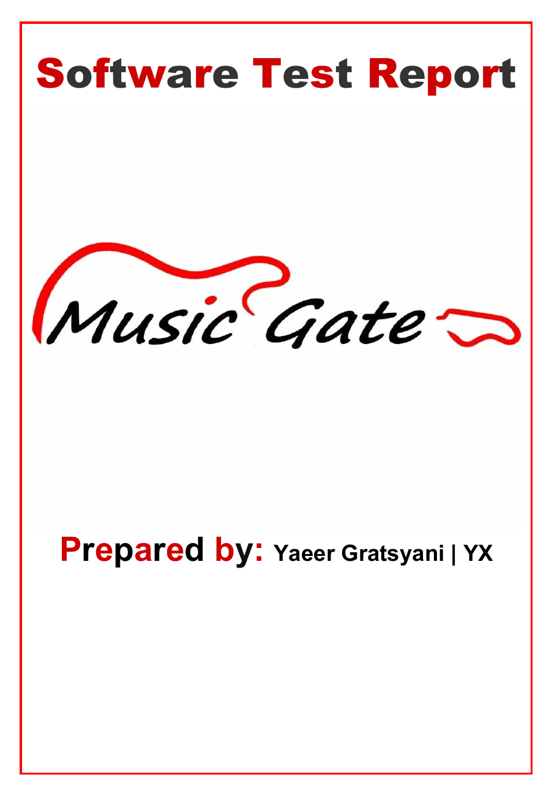
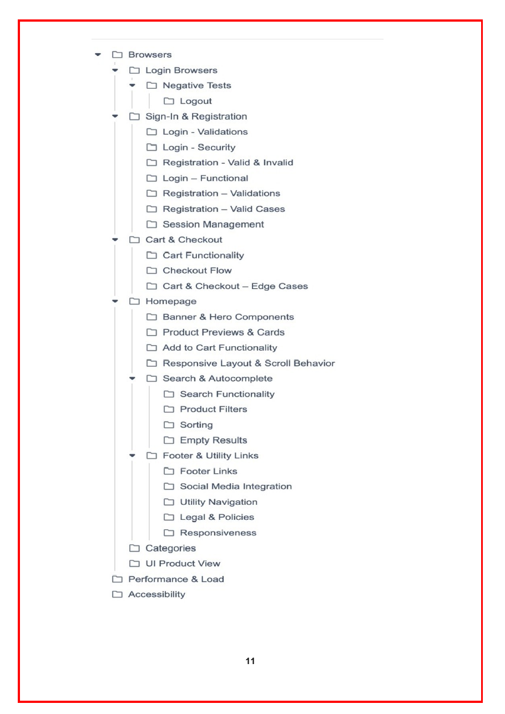
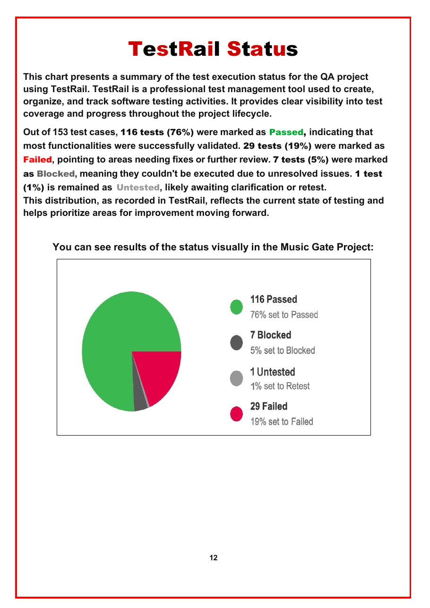
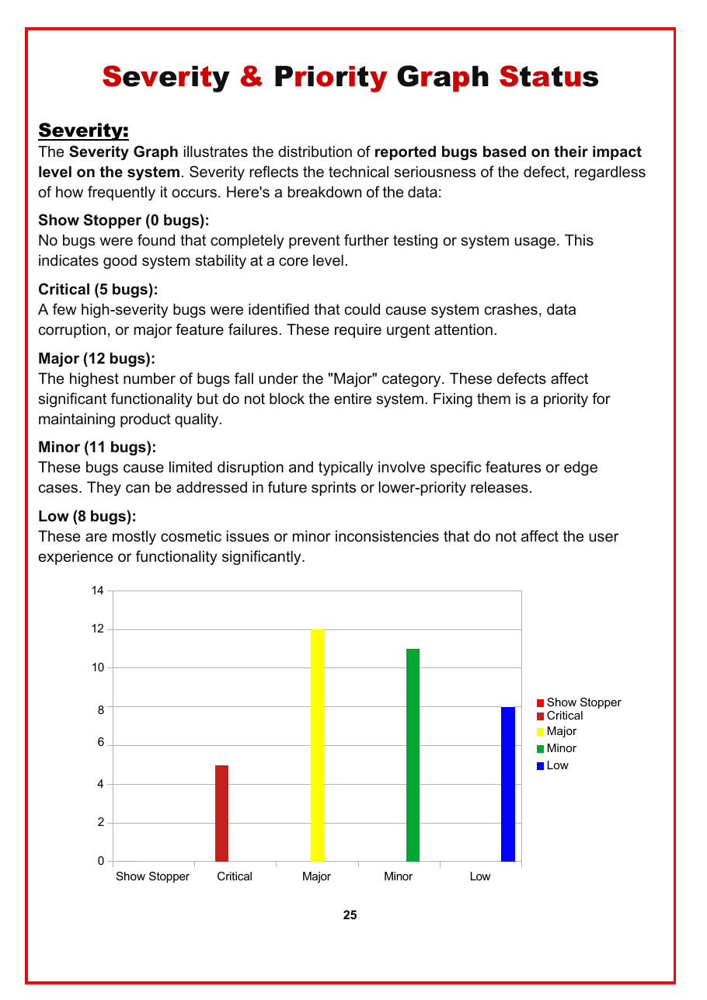
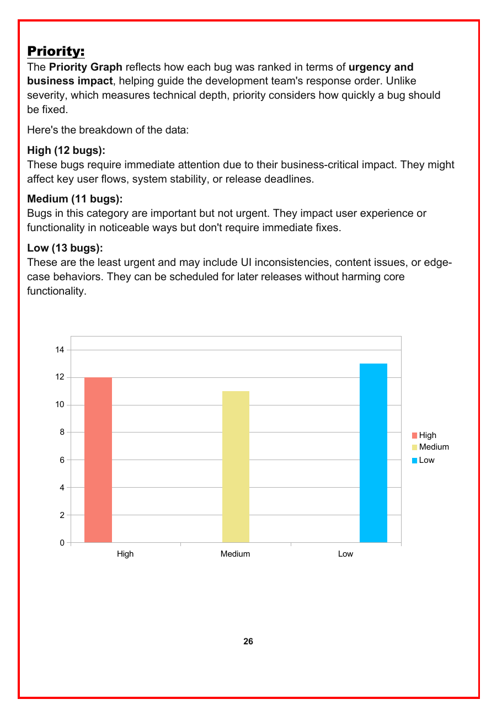
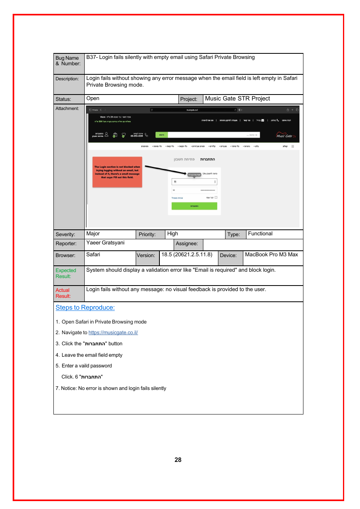
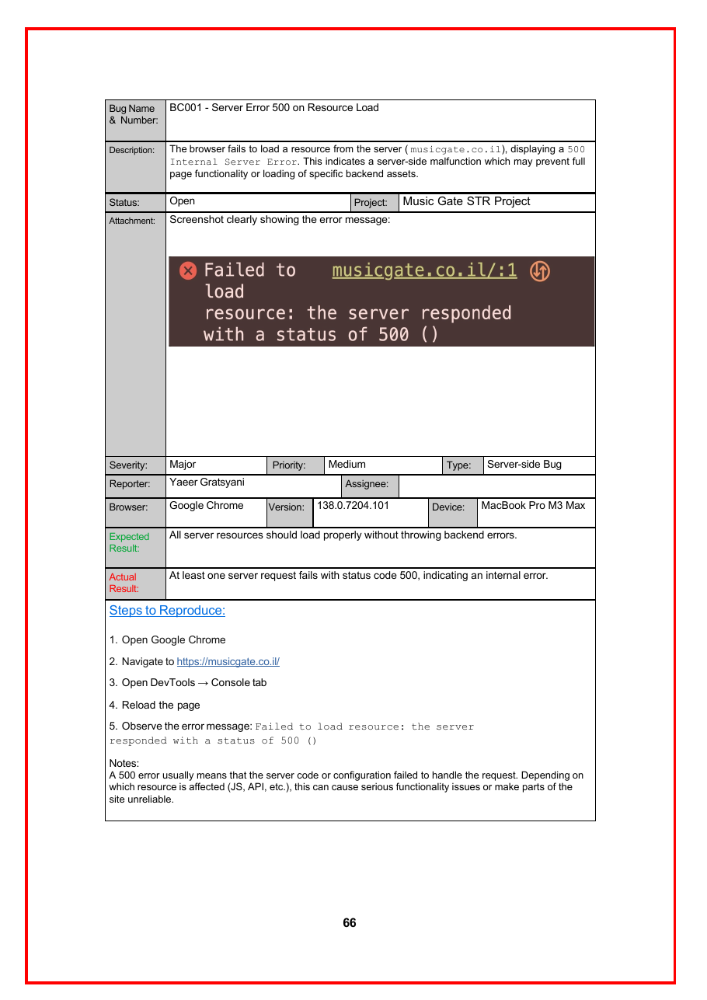

# 🎸 Music Gate: Software Test Report (STR)

Manual QA project for **[Music Gate](https://musicgate.co.il/)**, a live Israeli e-commerce website for musical instruments and audio equipment.

I planned, executed and documented a full QA cycle: a testing tree, 153 test cases in TestRail, 36 bug reports, 2 console bugs, and a first set of automated tests with Python and Selenium.

📄 **[Read the full STR (PDF, 82 pages)](Music%20Gate%20STR%20Project.pdf)**

<table>
<tr>
<td align="center"> STR cover</td>
<td align="center"> Testing tree: 36 sections</td>
</tr>
</table>

---

## 📊 Key Numbers

| Test Cases | Testing Sections | Bug Reports | Console Bugs | Automated Tests |
|:---:|:---:|:---:|:---:|:---:|
| **153** | **36** | **36** | **2** | **4** (Selenium) |

---

## ✅ Test Execution Results (TestRail)

| Status | Test Cases | % |
|---|:---:|:---:|
| ✅ Passed | 116 | 76% |
| ❌ Failed | 29 | 19% |
| ⛔ Blocked | 7 | 5% |
| ⏸️ Untested | 1 | 1% |
| **Total** | **153** | |

   TestRail execution status

---

## 🎯 Testing Scope

**Fully covered:** Functional · UI · Usability · Regression · Exploratory

**Partially covered:** Responsiveness & Compatibility · Performance · Accessibility · Security Awareness · Automation

**Main areas tested:** Login & Registration · Session Management · Cart & Checkout · Homepage · Search & Filters · Sorting · Categories · Footer & Utility Links · Responsiveness · Performance · Accessibility

**Browsers:** Google Chrome · Safari · Microsoft Edge · Firefox (including private modes), on macOS

---

## 🐞 Defects

### By Severity

| Show Stopper | Critical | Major | Minor | Low |
|:---:|:---:|:---:|:---:|:---:|
| 0 | 5 | 12 | 11 | 8 |

### By Priority

| High | Medium | Low |
|:---:|:---:|:---:|
| 12 | 11 | 13 |

<table>
<tr>
<td align="center"> Severity distribution</td>
<td align="center"> Priority distribution</td>
</tr>
</table>

### Critical Bugs

| ID | Bug |
|---|---|
| B111 | Invalid email format not detected on the registration page |
| B115 | Registration form accepts an invalid email format without an error |
| B124 | Session does not expire after an inactivity period |
| B166 | Keyboard navigation for accessibility is inconsistent |
| B168 | Checkout flow is not fully accessible using the keyboard only |

### Other Notable Findings

- **B106:** No lockout or CAPTCHA after multiple failed login attempts
- **B37 / B39:** Login fails silently with empty fields in Safari Private and Edge InPrivate
- **B129 to B134:** Cart icon does not update after adding, removing or changing product quantity
- **B147 to B150:** Category, brand, price and popularity filters do not affect search results

Every bug report includes a description, environment, steps to reproduce, expected vs. actual results, severity, priority and evidence.

   Example bug report (B37)

---

## 🖥️ Console Bugs (Chrome DevTools)

| ID | Bug | Severity | Priority |
|---|---|:---:|:---:|
| BC001 | Server error 500 on resource load | Major | Medium |
| BC002 | Uncaught TypeError when reading the `lcp` property (in a Promise) | Minor | Low |

   Console bug report (BC001)

---

## 🤖 First Steps in Automation

I wrote 4 automated tests with **Python + Selenium** (3 basic, 1 intermediate): loading the homepage, the guitar category page and a product page, and a search flow.

One test failed on an assertion error. Manual investigation showed it was a **real bug** and not a script issue, which taught me how manual testing and automation complement each other.

➡️ This project later evolved into a full automation framework with Playwright and Pytest: **[MusicGate-Automation](https://github.com/YaeerYX/MusicGate-Automation)**

---

## 📝 Release Recommendation

**Release with caution.** Core flows are stable, but form validation, error handling, UI responsiveness and accessibility need improvements, followed by regression testing.

---

## 🛠️ Tools

---

**Prepared by:** Yaeer Gratsyani | YX &nbsp;·&nbsp; [LinkedIn](https://www.linkedin.com/in/yx-/) &nbsp;·&nbsp; [GitHub](https://github.com/YaeerYX)
